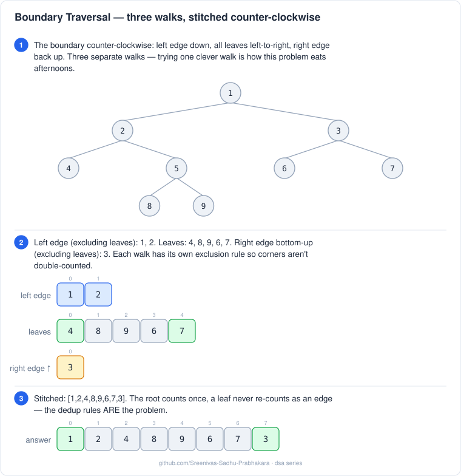

# Boundary Traversal

> Striver SDE Sheet 123 · Day 18 Binary Tree II — three separate walks (left edge down, leaves across, right edge up), each excluding what another walk owns. Go, stdlib only, tested.

## Problem

Walk a binary tree's outline anticlockwise: root, down the left edge, across all the leaves, back up the right edge — each boundary node exactly once. The difficulty is purely in the double-counting corners.

## Approach

Fight the urge to do it in one traversal; the boundary is three different *definitions* glued together, so three small walks are cleaner and each gets one exclusion rule. Left edge: follow Left (falling back to Right) but stop before the leaf — the leaf pass owns it. Leaves: plain DFS appending leaves only. Right edge: same as left but mirrored, collected top-down and emitted reversed, leaf again excluded. Roots that are themselves leaves return early so the single node isn't emitted twice. The tests are mostly about those corners: single node, skewed chains, leaves owned by inner subtrees.

**Complexity:** O(n) time, O(h) recursion.

## Visual walkthrough

Read the picture top to bottom — each numbered frame is one moment of the algorithm
running on this repo's test example.

## Run

    go test ./...   # verify
    go run .        # demo

---

One of 191 repos solving Striver's SDE Sheet in Go — stdlib only, one problem per repo, every solution tested. Browse the set: [`dsa-*` repos](https://github.com/Sreenivas-Sadhu-Prabhakara?tab=repositories&q=dsa-&type=source).
